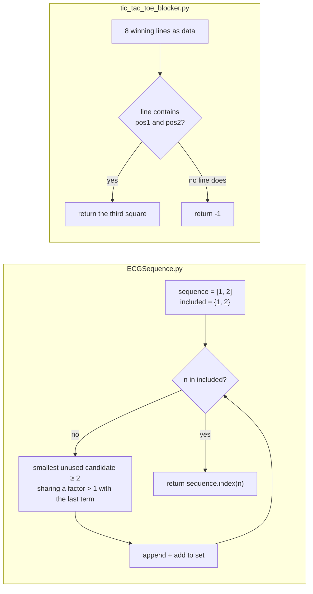

# Python Projects

Two short, standalone Python programs written in April 2024 while I was studying at the Luddy School of
Informatics, Computing, and Engineering at Indiana University. `ECGSequence.py` finds where a number first
appears in the EKG sequence, and `tic_tac_toe_blocker.py` returns the square that blocks a two-in-a-row in
tic-tac-toe. This is early learning work, kept public as a record of where my Python started. It is small on
purpose, and this README describes it at that size.

## At a glance

| | |
|---|---|
| **Status** | Finished small exercises (2024). No further work planned. |
| **Stack** | Python 3, standard library only. No dependencies, no tests. |
| **Run it** | `python3 ECGSequence.py` (prints `4`, `9`, `13`) |
| **Verified** | 2026-11-09 against `main` at `07b6e00`, with Python 3.9.6 on macOS ([how](#testing-and-ci)) |

## Why this exists

Both programs are small exercises in turning a precise rule into code, written as coursework-style problems
during my studies (the original 2024 README describes them as "concise and straightforward programs" from that
period).

- **The EKG sequence** (OEIS [A064413](https://oeis.org/A064413)) starts 1, 2, then each next term is the
  smallest positive integer not yet used that shares a factor greater than 1 with the previous term. The rule is
  easy to state and easy to get subtly wrong (forgetting "not yet used", or searching from the wrong starting
  point). The exercise is to generate the sequence only as far as needed and answer "at what position does `n`
  appear?".
- **The tic-tac-toe blocker** asks for the one square that stops an opponent who holds two squares of the same
  line. The question is how to represent the board so the answer falls out of a lookup instead of a pile of
  special cases. Listing the 8 winning lines as data does that.

What they show is limited and stated plainly: basic control flow, sets for membership checks, and modelling a
rule as data. They are not a library or a tool.

## What works today

| capability | status | how it was verified |
|---|---|---|
| `ecg_seq_index(n)` returns the 0-based index of `n` in the EKG sequence | Working for `n ≥ 1` | `python3 ECGSequence.py` printed `4`, `9`, `13` (2026-11-09); the indices of the first 20 terms all match OEIS A064413 (checked with a throwaway script, not committed) |
| `tic_tac_toe_blocker(pos1, pos2)` returns the blocking square, or `-1` | Working for two different squares 0–8 | called directly on 2026-11-09: `(0,1)→2`, `(1,0)→2`, `(2,4)→6`, `(0,5)→-1` |
| Input validation | Not built | `ecg_seq_index(0)` never returns (0 never enters the sequence); `tic_tac_toe_blocker(4, 4)` returns `3` instead of rejecting a repeated square |
| Tests | Not built | none in the repo |

## Quick start

**Requirements:** Python 3 (checked with 3.9.6). Nothing to install.

```bash
git clone https://github.com/AlexRosen23/Python-Projects.git
cd Python-Projects
python3 ECGSequence.py            # prints 4, 9 and 13: the positions of 3, 5 and 7
python3 -c "from tic_tac_toe_blocker import tic_tac_toe_blocker as b; print(b(0, 1))"   # prints 2
```

`python3 tic_tac_toe_blocker.py` on its own prints nothing: it only defines the function, and its example call is
a comment. Importing `ECGSequence` also prints the three example results, because the example calls run at
module level.

## How it works



**`ECGSequence.py`.** The sequence lives in a list (for the final `index` call) and a set (for constant-time
"already used?" checks). Each step scans candidates upward from 2 and tests the shared-factor rule by trial
division up to the smaller number. That is quadratic-ish, but fast enough here: finding 97 (index 181) takes about
0.01 s.

**`tic_tac_toe_blocker.py`.** The board is numbered 0–8 row by row. The 8 winning lines (3 rows, 3 columns, 2
diagonals) are a list. The function returns the remaining square of the first line that contains both given
squares. Two squares share at most one line, so the first match is the only one.

## How it was built

| date | commit | what |
|---|---|---|
| 2024-04-29 | `e0effa7` | `tic_tac_toe_blocker.py` |
| 2024-04-29 | `7f2822f` | first README (a short introduction) |
| 2024-04-29 | `2da30bb` | `ECGSequence.py` |
| 2026-11-07 | `817d23b`, [PR #1](https://github.com/AlexRosen23/Python-Projects/pull/1) | README rewritten with Claude Code |
| 2026-11-09 | [PR #2](https://github.com/AlexRosen23/Python-Projects/pull/2) | full write-up, with the code re-run and its limits measured |
| 2026-11-10 | audit | `.gitignore` for Python caches and virtual environments |

The two programs were written in April 2024, before Claude Code existed, and no Claude Code session on record
touched the code. The only AI-assisted changes are the README rewrites in 2026.

## Limitations and what's next

- **No input validation.** A non-positive `n` makes `ecg_seq_index` loop forever, and a repeated or out-of-range
  square gives the blocker a meaningless answer.
- **Example calls run on import** in `ECGSequence.py`. A `if __name__ == "__main__":` guard would fix that.
- **No tests.** The checks above were run by hand for this README.
- **Next, if this repo is ever revisited:** add the guards above and a few `pytest` cases built from OEIS A064413.
  Nothing is planned. Newer work lives in other repositories.

## Repository map

| path | what it is |
|---|---|
| `ECGSequence.py` | EKG sequence index finder (40 lines) |
| `tic_tac_toe_blocker.py` | tic-tac-toe blocking move (40 lines) |
| `README.md` | this file |
| `.gitignore` | keeps `__pycache__/`, virtual environments and macOS metadata out of git |

## Testing and CI

There is no test suite. For this README (2026-11-09, Python 3.9.6, macOS) I ran `python3 ECGSequence.py`
(output `4`, `9`, `13`, as the comments expect), checked the first 20 sequence positions against OEIS A064413,
and called the blocker on the cases in [What works today](#what-works-today).

GitHub Actions is enabled on this repository, but it has no workflow files, so nothing runs.

## Related

- The EKG sequence: [OEIS A064413](https://oeis.org/A064413).
- No license file is included, so default copyright applies.
